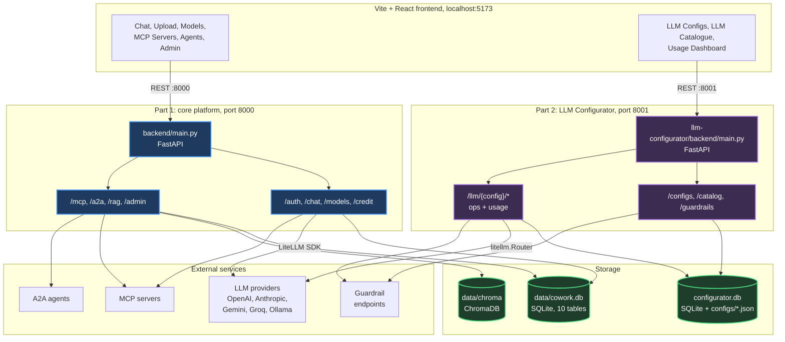
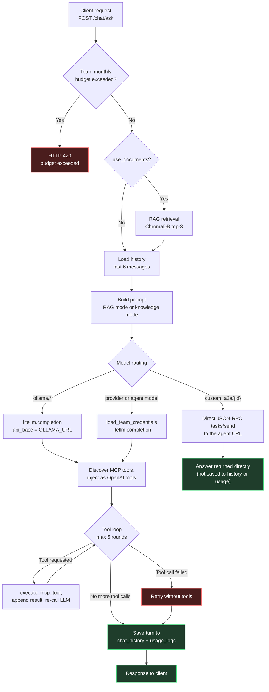
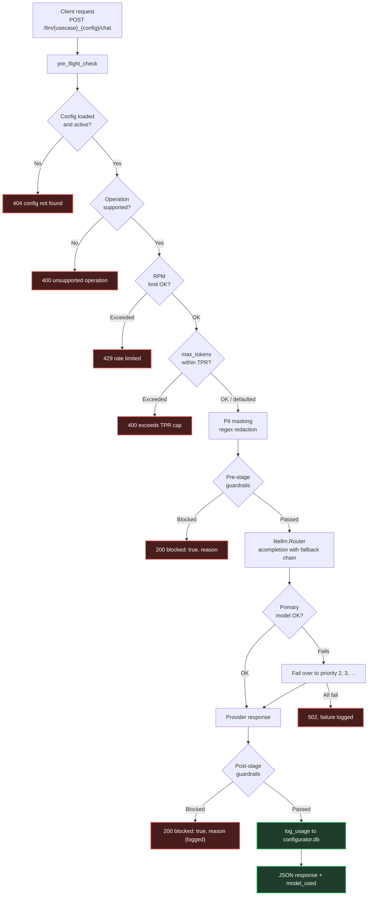
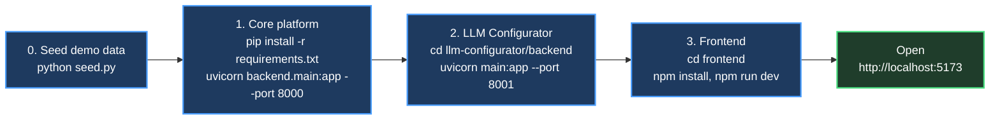
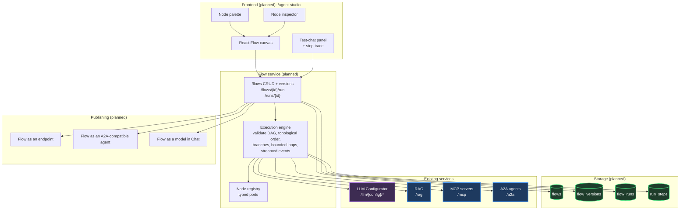

# AI Cowork

AI Cowork is a self-hosted team AI workspace. It runs as **two independent FastAPI backends behind one React frontend**:

1. **Core platform** (port `8000`): chat, document RAG, MCP tool calling, agent-to-agent (A2A) calls, JWT auth, team token budgets and an admin console.
2. **LLM Configurator** (port `8001`): an LLM gateway. Each named config goes live as a REST endpoint as soon as it is saved, with fallback chains, TPM / RPM / TPR limits, guardrails and a usage dashboard.

The two backends do not call each other. Each has its own entry point, dependency file and SQLite database. The only thing they share is the `ENCRYPTION_KEY` in the root `.env` (see [Configuration](#configuration)).

**Planned:** Agent Studio, a Langflow-style visual builder for agents and multi-agent workflows. See [Roadmap](#roadmap-agent-studio-visual-agent-builder). None of it is implemented yet.

---

## Contents

1. [Quick links](#quick-links)
2. [Features](#features)
3. [System architecture](#system-architecture)
4. [Project structure](#project-structure)
5. [How a chat request is handled](#how-a-chat-request-is-handled)
6. [How a Configurator request is handled](#how-a-configurator-request-is-handled)
7. [API overview](#api-overview)
8. [Getting started](#getting-started)
9. [Configuration](#configuration)
10. [Roadmap: Agent Studio (visual agent builder)](#roadmap-agent-studio-visual-agent-builder)

---

## Quick links

| Document | What it covers | Link |
|---|---|---|
| Core platform documentation | Architecture, RAG, MCP tool loop, A2A agents, auth, DB schema | [`DOCUMENTATION_CORE.md`](DOCUMENTATION_CORE.md) |
| LLM Configurator documentation | Gateway architecture, fallback chains, guardrails, analytics | [`llm-configurator/DOCUMENTATION.md`](llm-configurator/DOCUMENTATION.md) |
| LLM Configurator PDF | The same documentation as a PDF | [`llm-configurator/DOCUMENTATION.pdf`](llm-configurator/DOCUMENTATION.pdf) |
| Core platform requirements | Python dependencies for port 8000 | [`requirements.txt`](requirements.txt) |
| Configurator requirements | Python dependencies for port 8001 | [`llm-configurator/backend/requirements.txt`](llm-configurator/backend/requirements.txt) |

---

## Features

### Core platform (`backend/`, port 8000)

| Area | What the code does |
|---|---|
| **Chat** | `POST /chat/ask`. You choose the model for each message: a local Ollama model, an activated cloud model, or a registered agent. Short-term memory is the user's last 6 messages (3 question/answer pairs from `chat_history`). |
| **Document RAG** | Upload PDFs (parsed with `pypdf`) or UTF-8 text files. Text is split into 500-character chunks with 50 characters of overlap, embedded with SentenceTransformers `all-MiniLM-L6-v2` and stored in ChromaDB, one collection per team (`team_<id>`, cosine distance). The top 3 chunks are retrieved, and the response lists each chunk's source file and relevance score. |
| **Models** | A provider catalogue for OpenAI, Anthropic, Azure, Gemini, Groq, Mistral, Cohere and Together AI, plus the local Ollama models listed by `OLLAMA_URL/api/tags`. Each team saves its own provider credentials and activates its own models. Credentials are Fernet-encrypted at rest. All calls go through the LiteLLM SDK. |
| **MCP servers** | Admins register MCP servers (HTTP JSON-RPC; the client parses both SSE and plain JSON replies), with optional bearer-token or API-key auth stored Fernet-encrypted. On every chat request, tools from all active servers are fetched with `tools/list` and passed to the model as OpenAI-style function tools. The tool loop runs for up to 5 rounds. If tool calling fails, the request is retried once without tools. |
| **A2A agents** | Admins register agents of two kinds. **Custom**: a URL that is called directly with JSON-RPC `tasks/send`. **LiteLLM agent providers**: `langgraph`, `pydantic_ai`, `bedrock_agent`, `vertex_ai_agent` and `azure_ai_agent`, whose credentials are stored Fernet-encrypted per team. Any user can test or invoke an agent, or pick it as the model in Chat. |
| **Auth & teams** | JWT bearer tokens (HS256, signed with `JWT_SECRET`) and bcrypt password hashes. Every user belongs to one team and has the role `admin` or `member`. Signing up always creates a `member`. |
| **Budgets & credits** | Each team has a monthly token limit (100,000 by default). `/chat/ask` returns HTTP 429 once the team's usage for the current calendar month reaches the limit. Members can file one pending credit request per team. When an admin approves a request, the granted tokens are added to the team's limit. |
| **Admin console** | Platform stats, team creation, token-limit changes and credit-request review. |

### LLM Configurator (`llm-configurator/`, port 8001)

| Area | What the code does |
|---|---|
| **LLM Catalogue** | A global list of LiteLLM models (`/catalog/global_models`) with an optional API key and API base for each. Every config reuses these entries. The model picker is filled from LiteLLM's `model_cost` map. These API keys are currently stored **unencrypted** in `configurator.db`. |
| **Config builder** | A config is named `<usecase>_<config>`. For each operation you pick models and give each a priority (1 = primary, 2 = first fallback, and so on). Saving writes `llm-configurator/configs/<usecase>_<config>.json`, records the config in `configurator.db` and hot-loads a `litellm.Router`, so no restart is needed. |
| **Operations** | `chat`, `vision` (uses vision-capable chat models), `completions`, `embeddings`, `images/generations`, `audio/transcriptions` and `audio/speech`. **Custom operations** are named operations whose description is injected as the system prompt and which run on chat models. A call to an operation the config has no model for returns HTTP 400. |
| **Restrictions** | TPM and RPM per config, which individual models can override, are passed to the router. RPM is also enforced in the gateway with a 60-second sliding window, returning 429. TPR is the maximum tokens per request: if `max_tokens` is missing it is set to the TPR value, and if it is larger the request is rejected with 400. |
| **Guardrails** | **PII masking**: a regex redacts email addresses and phone numbers in user messages and prompts. **Custom pre/post guardrails**: HTTP endpoints using one of three adapters (`http_generic`, `huggingface_inference`, `openai_chat_safety`), with an action (block, redact, warn or log only), a fail mode (open or closed), a timeout, a circuit breaker (opens after 5 consecutive failures, for 60 s) and an SSRF check. The SSRF check always blocks the cloud metadata IP, and blocks private, loopback and link-local addresses unless `allow_local` is set. Guardrail bearer tokens are Fernet-encrypted. Post-stage guardrails run on non-streaming `/chat` responses. **Profanity filter**: the config schema has a `profanity_filter` flag, but nothing enforces it yet and the UI shows it as "Coming Soon". |
| **Usage dashboard** | Every call is logged with tokens, latency, cost (from `litellm.completion_cost`), finish reason, error type and whether a fallback fired. The dashboard shows a summary, a time series, breakdowns by model and by operation, and recent logs (Recharts), filtered by `range` = `24h`, `7d`, `30d` or `all`. |

---

## System architecture



### The two backends side by side

| | Part 1: core platform | Part 2: LLM Configurator |
|---|---|---|
| Port | `8000` | `8001` |
| Entry point | [`backend/main.py`](backend/main.py) (`uvicorn backend.main:app`, run from the repo root) | [`llm-configurator/backend/main.py`](llm-configurator/backend/main.py) (`uvicorn main:app`, run from `llm-configurator/backend`) |
| Engine | LiteLLM SDK (`litellm.completion`) with a tool loop. Sentence-Transformers + ChromaDB for RAG. | One `litellm.Router` per config (`usage-based-routing-v2`, priority `order`, 2 retries, 120 s timeout) |
| Database paths | `./data/cowork.db` (`DATABASE_PATH`), `./data/chroma` (`CHROMA_PATH`) | `llm-configurator/backend/configurator.db` (fixed path), `llm-configurator/configs/*.json` |
| Tables | `teams`, `users`, `documents`, `chat_history`, `usage_logs`, `credit_requests`, `configured_models`, `provider_credentials`, `mcp_servers`, `registered_agents` | `llm_configs`, `usage_logs`, `global_models`, `guardrail_events` |
| Auth | JWT bearer token on most routes | None. Every route is open. |
| Requirements | [`requirements.txt`](requirements.txt) | [`llm-configurator/backend/requirements.txt`](llm-configurator/backend/requirements.txt) |
| Docs | [`DOCUMENTATION_CORE.md`](DOCUMENTATION_CORE.md) | [`llm-configurator/DOCUMENTATION.md`](llm-configurator/DOCUMENTATION.md) |

### Tech stack

| Layer | Technology |
|---|---|
| Frontend | React 19, Vite 8, React Router 7, Tailwind CSS 4, Axios, Recharts, Framer Motion, Heroicons |
| Backends | Python, FastAPI, Uvicorn, Pydantic |
| LLM access | LiteLLM (SDK in core, `Router` in Configurator), Ollama for local models |
| RAG | ChromaDB, Sentence-Transformers, LangChain text splitters, pypdf |
| Auth & secrets | python-jose (JWT), passlib + bcrypt, `cryptography` Fernet |
| Storage | SQLite (two separate files), ChromaDB persistent client, JSON config files |

---

## Project structure

```text
coworkAI/
├── backend/                      # Part 1: core platform (port 8000)
│   ├── main.py                   # FastAPI app, CORS, router mounting, /health
│   ├── config.py                 # Settings from .env (auto-generates ENCRYPTION_KEY)
│   ├── database.py               # SQLite schema (10 tables) + secret-encryption migration
│   ├── auth/                     # signup/login/me, JWT + bcrypt, Fernet helpers
│   ├── chat/                     # /chat/ask (RAG + memory + MCP tool loop + A2A), usage
│   ├── rag/                      # upload/list/delete docs, chunking, embeddings, retrieval
│   ├── models/                   # provider catalogue, team credentials, model activation
│   ├── mcp_client/               # MCP server registry, tools/list + tools/call
│   ├── a2a/                      # agent registry, custom JSON-RPC + LiteLLM agent providers
│   ├── credit/                   # team credit requests
│   ├── admin/                    # stats, teams, token limits, credit review
│   ├── guardrails/pii_shield.py  # PII redaction helper (not wired into the API yet)
│   └── services/                 # rate limiter + task manager (not wired into the API yet)
├── llm-configurator/
│   ├── DOCUMENTATION.md / .pdf
│   └── backend/                  # Part 2: LLM Configurator (port 8001)
│       ├── main.py               # FastAPI app, guardrail-block handler, router mounting
│       ├── routes/               # config, llm (ops), catalog, usage, guardrail routes
│       ├── router_manager.py     # builds and caches one litellm.Router per config
│       ├── config_store.py       # configs/*.json + llm_configs table
│       ├── guardrail_runner.py   # custom guardrail adapters, circuit breaker
│       ├── ssrf.py               # URL validation for guardrail endpoints
│       ├── rate_limiter.py       # in-memory 60 s RPM window
│       ├── catalog.py, schemas.py, db.py, encryption.py
│       ├── scripts/seed_usage.py # ~300 synthetic usage rows for the dashboard
│       └── requirements.txt
├── frontend/                     # Vite + React app (port 5173)
│   └── src/
│       ├── App.jsx               # routes
│       ├── api.js                # axios client for :8000 (JWT header)
│       ├── components/           # Sidebar (role-based links), ChatMessage
│       ├── context/              # AuthContext (TaskContext is present but unused)
│       └── pages/                # Chat, Upload, Models, Admin, MCPServers, Agents, Login
│           └── LLMConfigurator/  # list, builder, detail/dashboard, catalogue, configApi.js (:8001)
├── agents/
│   ├── calculator_agent/agent.py # Pydantic AI calculator agent on Ollama, port 5002
│   └── mock_langgraph/agent.py   # mock A2A JSON-RPC agent, port 5003
├── mock_agent.py                 # mock A2A JSON-RPC agent at :5001/a2a
├── seed.py                       # demo teams and users
├── start.sh                      # starts the core backend on :8000 with --reload
├── docker-compose.yaml           # optional LiteLLM proxy on :4000
├── litellm_config.yaml           # config for that proxy (ollama/llama3.1)
├── requirements.txt              # core platform dependencies
└── DOCUMENTATION_CORE.md
```

The repo root also has ad-hoc helper scripts that are not part of either app: `audit_script.py`, `test_pii_guardrail.py`, `mock_testing_agent.py` and `scratch/`.

### Frontend routes

In `App.jsx`, every route except `/login` only checks that you are logged in. There is no role check at the route level: admin links are hidden by `Sidebar.jsx`. A member who types an admin URL can still open most of these pages. The exceptions are `Agents.jsx`, which redirects non-admins to `/`, and `Admin.jsx`, which hides its admin-only controls. On the backend, admin-only core routes return 403 to members, but the Configurator has no auth and accepts every call.

| Route | Page | Sidebar link shown to |
|---|---|---|
| `/login` | `Login.jsx` (login + signup) | n/a (public) |
| `/` | `Chat.jsx` | All users ("Chat") |
| `/upload` | `Upload.jsx` | All users ("Upload Documents") |
| `/models` | `Models.jsx` | All users ("Models") |
| `/admin` | `Admin.jsx` | Admins only ("Admin Dashboard") |
| `/mcp-servers` | `MCPServers.jsx` | Admins only ("MCP Servers") |
| `/agents` | `Agents.jsx` | Admins only ("Agents") |
| `/llm-configurator` | `ConfiguratorList.jsx` | Admins only ("LLM Configs") |
| `/llm-configurator/new` | `ConfiguratorBuilder.jsx` | No link (opened from LLM Configs) |
| `/llm-configurator/:fullName` | `ConfiguratorDetail.jsx` (config, playground, usage dashboard) | No link (opened from LLM Configs) |
| `/llm-configurator/:fullName/edit` | `ConfiguratorBuilder.jsx` | No link (opened from LLM Configs) |
| `/llm-catalogue` | `LLMCatalogue.jsx` | Admins only ("LLM Catalogue") |

---

## How a chat request is handled

`POST /chat/ask` on the core platform, with body `{"question", "model", "use_documents"}`:



LiteLLM rate-limit errors are retried up to 3 times, 5 seconds apart, before the user sees a rate-limit message.

## How a Configurator request is handled

`POST /llm/{usecase}_{config}/chat` on the gateway. The other operations follow the same steps.



---

## API overview

Interactive OpenAPI docs are served at **http://localhost:8000/docs** (core platform) and **http://localhost:8001/docs** (Configurator).

### Core platform (port 8000)

Auth column: **none** = public, **user** = any valid JWT, **admin** = JWT with role `admin`.

| Method | Path | Auth | Purpose |
|---|---|---|---|
| GET | `/health` | none | Liveness check |
| POST | `/auth/signup` | none | Create a `member` in an existing team and return a JWT |
| POST | `/auth/login` | none | Email + password, returns a JWT |
| GET | `/auth/me` | user | Current user and team |
| GET | `/chat/models` | none | Ollama models from `OLLAMA_URL/api/tags` (falls back to `MODEL_NAME`) |
| GET | `/chat/usage` | user | Team's monthly token usage against its limit |
| POST | `/chat/ask` | user | Ask a question (RAG, memory, MCP tools, agents) |
| POST | `/rag/upload` | user | Upload a PDF or text file into the team's knowledge base |
| GET | `/rag/documents` | user | List the team's documents |
| DELETE | `/rag/documents/{doc_id}` | user | Delete a document and its chunks |
| GET | `/models/providers` | user | Provider catalogue |
| GET | `/models/providers/{provider_id}` | user | One provider's models and credential fields |
| POST | `/models/credentials` | user | Save a team credential (Fernet-encrypted) |
| POST | `/models/activate` | user | Activate a model for the team |
| POST | `/models/deactivate` | user | Deactivate a model for the team |
| GET | `/models/active` | user | Ollama models plus the team's active cloud models |
| POST | `/mcp/servers` | admin | Register an MCP server |
| GET | `/mcp/servers` | user | List MCP servers |
| GET | `/mcp/servers/{server_id}/tools` | user | List a server's tools (`tools/list`) |
| POST | `/mcp/tools/call` | user | Call a tool directly (`tools/call`) |
| DELETE | `/mcp/servers/{server_id}` | admin | Remove an MCP server |
| GET | `/a2a/provider-specs` | user | Credential fields for the LiteLLM agent providers |
| POST | `/a2a/agents` | admin | Register an agent (custom or LiteLLM provider) |
| GET | `/a2a/agents` | user | List agents with credential status and model string |
| DELETE | `/a2a/agents/{agent_id}` | admin | Remove an agent |
| POST | `/a2a/agents/{agent_id}/invoke` | user | Send a message to an agent |
| POST | `/a2a/agents/{agent_id}/test` | user | Connectivity test |
| POST | `/credit/request` | user | Request more tokens for the team |
| GET | `/credit/requests` | user | The team's credit requests |
| GET | `/admin/stats` | user | Platform stats (the frontend shows this page to admins only) |
| GET | `/admin/teams` | none | List teams (used by the signup form) |
| POST | `/admin/teams` | admin | Create a team |
| PUT | `/admin/teams/{team_id}/limit` | admin | Set a team's monthly token limit |
| GET | `/admin/credit-requests` | admin | All credit requests |
| PUT | `/admin/credit-requests/{request_id}` | admin | Approve or deny (approved tokens are added to the limit) |

### LLM Configurator (port 8001)

`{full_name}` is `<usecase>_<config>`. None of these routes require auth.

| Method | Path | Purpose |
|---|---|---|
| POST | `/configs` | Create a config (writes JSON, builds the router) |
| GET | `/configs` | List configs |
| GET | `/configs/{full_name}` | Get one config |
| PUT | `/configs/{full_name}` | Update a config (rebuilds the router) |
| DELETE | `/configs/{full_name}` | Delete a config |
| GET | `/catalog/models` | LiteLLM model catalogue (`provider`, `mode`, `q` filters) |
| GET | `/catalog/operations` | Supported operations |
| GET | `/catalog/global_models` | LLM Catalogue entries |
| POST | `/catalog/global_models` | Add or update a catalogue entry |
| DELETE | `/catalog/global_models/{litellm_model}` | Remove a catalogue entry |
| POST | `/guardrails/test` | Test a custom guardrail definition against sample text |
| POST | `/llm/{full_name}/chat` | Chat completion |
| POST | `/llm/{full_name}/vision` | Chat completion with image input |
| POST | `/llm/{full_name}/completions` | Text completion |
| POST | `/llm/{full_name}/embeddings` | Embeddings |
| POST | `/llm/{full_name}/images/generations` | Image generation |
| POST | `/llm/{full_name}/audio/transcriptions` | Speech to text (multipart form) |
| POST | `/llm/{full_name}/audio/speech` | Text to speech |
| POST | `/llm/{full_name}/{custom_op}` | Custom operation (its description becomes the system prompt) |
| GET | `/llm/{full_name}/capabilities` | Operations and custom operations this config supports |
| GET | `/llm/{full_name}/usage` | Totals, per-endpoint and per-agent rollups, current RPM window |
| GET | `/llm/{full_name}/usage/summary` | Dashboard summary (`range`, `model`) |
| GET | `/llm/{full_name}/usage/timeseries` | Dashboard time series (`range`, `model`) |
| GET | `/llm/{full_name}/usage/by-model` | Breakdown by model (`range`) |
| GET | `/llm/{full_name}/usage/by-operation` | Breakdown by operation (`range`) |
| GET | `/llm/{full_name}/logs/recent` | Most recent calls (`limit`) |

Example call to a config with use case `doc_summariser` and config name `LLM_config`. The optional `X-Agent-Id` header is recorded in the usage logs.

```bash
curl -X POST http://localhost:8001/llm/doc_summariser_LLM_config/chat \
  -H "Content-Type: application/json" \
  -H "X-Agent-Id: my-service" \
  -d '{
        "messages": [
          {"role": "system", "content": "Summarise the user text in three bullet points."},
          {"role": "user", "content": "AI Cowork runs two FastAPI backends behind one React frontend..."}
        ]
      }'
```

The response is the LiteLLM response object with a `model_used` field added. If a guardrail blocks the request, the response is HTTP 200 with `{"blocked": true, "reason": "..."}`.

---

## Getting started

### Prerequisites

| Tool | Notes |
|---|---|
| Python 3.10+ | Both backends. Use a separate virtualenv for each if you like, since their dependency pins differ. |
| Node.js 20.19+ (or 22.12+) and npm | Required by Vite 8 for the frontend |
| [Ollama](https://ollama.com) with `llama3.1` | `ollama pull llama3.1`. This is the default chat model (`MODEL_NAME=ollama/llama3.1`) and is used by the sample calculator agent. |

### Start-up order



Start the core platform before the Configurator, or set `ENCRYPTION_KEY` in the root `.env` yourself. The core platform generates that key on its first start. The Configurator reads it from the root `.env` and refuses to start without it.

### 1. Core platform (port 8000)

```bash
# from the repo root
pip install -r requirements.txt
python seed.py          # creates tables, demo teams and users (also generates ENCRYPTION_KEY)
./start.sh              # same as: python -m uvicorn backend.main:app --reload --port 8000
```

`seed.py` creates:

| Teams | Users |
|---|---|
| Engineering, HR, Sales | `admin@cowork.ai` / `admin123` (admin, Engineering)<br>`dev@cowork.ai` / `test123` (member, Engineering)<br>`hr@cowork.ai` / `test123` (member, HR)<br>`sales@cowork.ai` / `test123` (member, Sales) |

> [!WARNING]
> These are **demo credentials only**. Change or delete these users, and set a real `JWT_SECRET`, before exposing the app to anyone else.

### 2. LLM Configurator (port 8001)

```bash
cd llm-configurator/backend
pip install -r requirements.txt
python -m uvicorn main:app --port 8001 --reload

# optional: ~300 synthetic usage rows for a config named "hello_llm"
python scripts/seed_usage.py
```

### 3. Frontend (port 5173)

```bash
cd frontend
npm install
npm run dev
```

Open http://localhost:5173 and log in. The frontend calls the core platform at `http://localhost:8000` (`src/api.js`) and the Configurator at `http://127.0.0.1:8001` (`src/pages/LLMConfigurator/configApi.js`). Both backends only allow CORS from `http://localhost:5173`.

### Optional: sample A2A agents

| Agent | Run | Endpoint to register | Notes |
|---|---|---|---|
| Mock agent | `python mock_agent.py` | `http://localhost:5001/a2a` (custom) | Replies to JSON-RPC `tasks/send` by echoing the message |
| Calculator agent | `python agents/calculator_agent/agent.py` | `http://127.0.0.1:5002/` (custom) or as a `pydantic_ai` agent | Needs `pip install pydantic-ai`. Calls Ollama `llama3.1` through its OpenAI-compatible API. |
| Mock LangGraph agent | `python agents/mock_langgraph/agent.py` | `http://127.0.0.1:5003/` (custom) or as a `langgraph` agent | Mock JSON-RPC agent |

Register agents on the **Agents** page (admins only).

### Optional: LiteLLM proxy (docker-compose)

`docker compose up -d` starts a LiteLLM proxy on `:4000` using `litellm_config.yaml`. That config exposes `ollama/llama3.1` as `local-llama`, with master key `sk-cowork-master-key`. **Neither backend needs it**: both call providers directly through the LiteLLM Python SDK.

---

## Configuration

The core platform reads `.env` in the repo root (`backend/config.py`, via `python-dotenv`).

| Variable | Default | Used by | Purpose |
|---|---|---|---|
| `JWT_SECRET` | `fallback-secret` | core | Signs JWTs. **Set this.** |
| `ENCRYPTION_KEY` | auto-generated | core + Configurator | Fernet key for stored secrets. If it is missing, the core platform generates one on start-up and appends it to the root `.env`. |
| `DATABASE_PATH` | `./data/cowork.db` | core | SQLite database |
| `CHROMA_PATH` | `./data/chroma` | core | ChromaDB persistent store |
| `OLLAMA_URL` | `http://localhost:11434` | core | Ollama server for `ollama/*` models and the model list |
| `MODEL_NAME` | `ollama/llama3.1` | core | Default chat model when the request has none |
| `EMBEDDING_MODEL` | `all-MiniLM-L6-v2` | core | Sentence-Transformers embedding model |
| `LANGGRAPH_API_BASE` | none | core (`chat`, `a2a`) | `api_base` for `langgraph/*` agent models |
| `PYDANTIC_AI_API_BASE` | none | core (`chat`, `a2a`) | `api_base` for `a2a/*` (Pydantic AI) agent models |
| `A2A_API_BASE` | none | core (`chat`, `a2a`) | Fallback `api_base` for `a2a/*` models when `PYDANTIC_AI_API_BASE` is unset |

The three agent base URLs are read with `os.environ.get(...)`. They can come from `.env`, or from the agent credentials saved in the UI, which are loaded into the environment before each call.

> [!NOTE]
> Known issue: `backend/chat/routes.py` uses `os.environ` without `import os`. Selecting a `langgraph/*` or `a2a/*` agent as the model in Chat currently fails with a server error. The `/a2a/agents/{id}/invoke` and `/test` routes are not affected.

The constants `CHUNK_SIZE = 500`, `CHUNK_OVERLAP = 50` and `TOP_K = 3` are set in `backend/config.py` and are not read from the environment.

**LLM Configurator.** `main.py` calls `load_dotenv()`, which loads a `.env` from the directory you start it in (`llm-configurator/backend`). Use that file for provider keys referenced by a model's `api_key_env`. `encryption.py` separately loads the **root** `.env` to read `ENCRYPTION_KEY`. The database path (`llm-configurator/backend/configurator.db`) and the configs directory (`llm-configurator/configs/`) are fixed in code.

**Git-ignored paths** (`.gitignore`): `.env`, `data/`, `*.db` (including `configurator.db`), `llm-configurator/configs/`, `llm-configurator/backend/*.log`, `__pycache__/`, `*.pyc`, `node_modules/`, `dist/` and `venv/`. Secrets, databases and saved configs are never committed.

---

## Roadmap: Agent Studio (visual agent builder)

> **Status: planned, nothing implemented yet.** Everything in this section is a proposal. No Agent Studio code, routes, tables or UI exist in the repository today.

### Goal

Agent Studio would be a Langflow-style drag-and-drop canvas inside AI Cowork. Non-developers could use it to build low-code / no-code agents and to orchestrate several agents into one workflow, reusing the LLMs, knowledge, tools and agents the platform already manages.

### Canvas nodes and what they would build on

| Node | Status | Would build on |
|---|---|---|
| **LLM** | Existing building block | LLM Configurator configs (`/llm/{full_name}/*`), including their fallbacks, TPM/RPM/TPR limits and guardrails |
| **Knowledge / Retriever** | Existing building block | Core RAG (`backend/rag`, ChromaDB per team) |
| **Tool** | Existing building block | Registered MCP servers (`backend/mcp_client`) |
| **Agent** | Existing building block | A2A agent registry (`backend/a2a`): custom JSON-RPC and LiteLLM agent providers |
| **Guardrail** | Existing building block | The Configurator's guardrail runner (PII masking, custom pre/post guardrails) |
| **Memory** | Existing building block | Chat memory (`backend/chat/memory.py`) |
| **Prompt template** | New | Templated prompts with typed variables |
| **Router / Condition** | New | Branch on LLM classification or on expressions |
| **Loop / Map** | New | Bounded iteration over lists |
| **Human-in-the-loop** | New | Pause a run for approval or input |
| **Input / Output** | New | Chat input/output, webhook / API trigger, structured (JSON-schema) output |

### Two levels

1. **Agent builder.** Build a single agent from LLM + prompt + tools + knowledge + memory. A saved agent would appear in the agent registry and could be selected as the model in Chat, like the agents registered today.
2. **Orchestrator.** Multi-agent workflows using these patterns:

   | Pattern | Description |
   |---|---|
   | Sequential | Agents run one after another, each passing its output on |
   | Supervisor / router | A coordinator chooses which agent handles each step |
   | Parallel fan-out / merge | Several agents run at once and their results are merged |
   | Hierarchical | Supervisors that delegate to sub-teams of agents or to sub-flows |

### Proposed architecture



| Component | Planned responsibility |
|---|---|
| Canvas (`/agent-studio`) | React Flow editor with a node palette, an inspector for node settings, a test-chat panel and a per-step trace |
| Flow API | `/flows` CRUD with versioning, `/flows/{id}/run` to start a run, `/runs/{id}` for run status and steps |
| Execution engine | Validates the graph as a DAG, runs nodes in topological order with branches and bounded loops, and streams step events to the UI |
| Node registry | One definition per node type with typed input/output ports, so the canvas can reject invalid connections |
| Storage | New tables: `flows`, `flow_versions`, `flow_runs`, `run_steps` |
| Publishing | A published flow becomes a REST endpoint, an A2A-compatible agent and a model you can select in Chat |
| Observability | Per-node tokens, latency and cost, reusing the Configurator's usage logging |

### Example flow definition (proposed format)

A support triage flow. A router sends billing questions to an external A2A agent, and sends technical questions to a retriever plus an agent that has a Jira MCP tool.

```json
{
  "name": "support_triage",
  "version": 1,
  "nodes": [
    { "id": "in",        "type": "chat_input" },
    { "id": "route",     "type": "router",
      "config": { "llm": "support_router_config", "routes": ["billing", "technical"] } },
    { "id": "kb",        "type": "retriever",
      "config": { "team": "Engineering", "top_k": 3 } },
    { "id": "tech",      "type": "agent",
      "config": { "llm": "support_LLM_config",
                  "prompt": "Answer using the retrieved docs. Open a Jira ticket if it is a bug.",
                  "tools": ["mcp:jira"] } },
    { "id": "billing",   "type": "a2a_agent",
      "config": { "agent": "billing-agent" } },
    { "id": "out",       "type": "chat_output" }
  ],
  "edges": [
    { "from": "in",      "to": "route" },
    { "from": "route",   "to": "kb",      "when": "technical" },
    { "from": "kb",      "to": "tech" },
    { "from": "route",   "to": "billing", "when": "billing" },
    { "from": "tech",    "to": "out" },
    { "from": "billing", "to": "out" }
  ]
}
```

### Phases

| Phase | Scope |
|---|---|
| **1. Foundations** | Flow schema, `/flows` CRUD with versions, a node registry that wraps the existing features (Configurator LLM, RAG, MCP, A2A), and a linear execution engine |
| **2. Canvas** | React Flow editor, port type checks, node inspector, test chat and run trace |
| **3. Agent builder** | A single-agent template, and publishing to the agent registry and to Chat |
| **4. Orchestration** | Router, parallel fan-out/merge, bounded loops, human-in-the-loop, sub-flows and multi-agent templates |
| **5. Operate** | Run history and cost, permissions and sharing, import/export, webhook and scheduled triggers |
